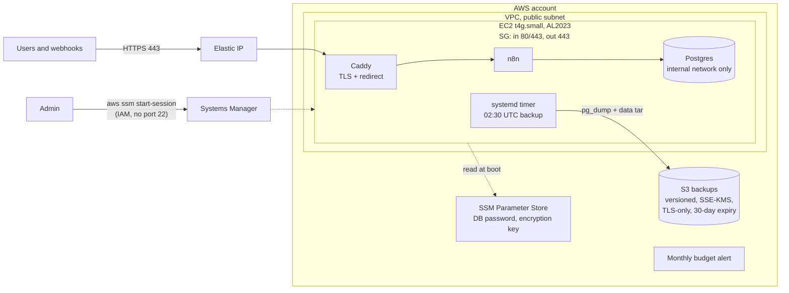

# Production-safe self-hosted n8n on AWS

[](https://github.com/YounessAbbida/gha-n8n-aws/actions/workflows/ci.yml)

> **Reference implementation — not deployed.** This repository is published as
> code and documentation only. It has not been applied to an AWS account, and
> nothing here claims a live run. CI checks the code on every push
> (`terraform fmt`/`validate`, tflint, Checkov, shellcheck, Compose and Caddy
> config validation) without any AWS credentials.

n8n and Postgres on one EC2 instance, behind Caddy with automatic HTTPS. No SSH
port, nightly backups to S3, and a one-command upgrade that rolls itself back
if the new version does not come up healthy.

## Problem

A typical self-hosted n8n is a `docker run` on a VPS: SQLite or an exposed
database, port 22 open to the world, no backups, an encryption key nobody wrote
down, and upgrades done by hand while hoping the migrations work. The first
failed upgrade or lost disk takes every workflow and stored credential with it.

## Result

- **HTTPS by default.** Caddy gets and renews a Let's Encrypt certificate;
  plain HTTP only serves the ACME challenge and a redirect.
- **No SSH.** The security group opens 80 and 443 only. Shell access is
  through AWS Systems Manager Session Manager, authenticated with IAM.
- **Nightly backups.** A systemd timer dumps Postgres and archives the n8n
  data directory to a versioned, encrypted S3 bucket with a 30-day lifecycle.
- **One-command upgrade.** `upgrade.sh 2.43.0` backs up first, upgrades, waits
  for the health check, and restores the pre-upgrade backup if it fails.
- **Scripted restore path.** `restore.sh latest` rebuilds the database, the data
  directory and the matching n8n version from S3.
- **Secrets outside Terraform.** The Postgres password and n8n encryption key
  are generated on the instance and stored in SSM Parameter Store, so they are
  never in Terraform state and survive an instance rebuild.

## Architecture



## Security decisions

| Decision | Why | Where |
|---|---|---|
| No port 22, Session Manager only | No SSH keys to manage, no brute-force surface, every session is IAM-authenticated | `terraform/network.tf`, `iam.tf` |
| Ingress 80/443 only, egress 443 only | Smallest network surface that still allows ACME, updates and HTTPS APIs | `network.tf` |
| Postgres on an internal Docker network | Database has no route to the internet and is not reachable from Caddy | `stack/docker-compose.yml` |
| n8n published on `127.0.0.1` only | Public traffic must go through Caddy; the host can still health-check | `docker-compose.yml` |
| IMDSv2 required, hop limit 1 | Containers cannot reach instance credentials | `ec2.tf` |
| Encrypted gp3 root volume | Data at rest is encrypted | `ec2.tf` |
| Secrets generated on the instance, stored as SecureString | Not in the repo, not in Terraform state, survive rebuilds | `templates/user_data.sh.tftpl` |
| Instance role limited to its own parameter path and `backups/` prefix | A compromised instance cannot read other secrets or delete other data | `iam.tf` |
| Backup bucket: public access blocked, versioning, SSE-KMS, TLS-only policy, lifecycle | Backups are private, recoverable and do not grow forever | `backup_bucket.tf` |
| Pinned versions: n8n, Postgres, Caddy, Compose (SHA-256 verified) | Reproducible builds; upgrades are deliberate | `variables.tf`, `docker-compose.yml` |
| Budget alert created with the stack | Cost guardrail from the first apply | `budget.tf` |
| `ignore_changes` on AMI and user data | A Terraform apply never replaces the server by surprise | `ec2.tf` |

Checkov exceptions are commented inline next to each resource with the reason.

### What a production setup adds

Access logging for the backup bucket, a customer managed KMS key, VPC flow
logs, Session Manager session logging to S3/CloudWatch, CloudWatch agent with
disk and memory alarms, cross-region backup copies, and SMTP egress if
workflows send mail. For high availability: n8n queue mode with Redis and
workers, and RDS instead of a Postgres container.

## Repository layout

```
terraform/                VPC, security group, EC2, IAM, S3 backups, budget
  templates/user_data.sh.tftpl   first boot: Docker, Compose, secrets, stack, backup timer
stack/
  docker-compose.yml      n8n + Postgres + Caddy
  Caddyfile               HTTPS reverse proxy
  scripts/backup.sh       pg_dump + data dir to S3
  scripts/restore.sh      restore a backup (latest or by id)
  scripts/upgrade.sh      backup, upgrade, health check, automatic rollback
  systemd/                nightly backup timer
docs/RUNBOOK.md           deploy, access, upgrade, restore, rebuild, teardown
.github/workflows/ci.yml  fmt, validate, tflint, checkov, shellcheck, compose/caddy validation, actionlint
```

## How to run it

Full commands are in [docs/RUNBOOK.md](docs/RUNBOOK.md). In short:

1. Fill in `terraform/terraform.tfvars` from the example (domain, emails).
2. `terraform apply`; point DNS at the `elastic_ip` output (automatic with Route 53).
3. Open `https://<domain>` and create the owner account.
4. Upgrade: `sudo /opt/n8n/scripts/upgrade.sh <version>` from a Session Manager shell.
5. Restore: `sudo /opt/n8n/scripts/restore.sh latest`.

## Cost

Estimated at roughly **$20 per month** in `eu-west-3` if run: a t4g.small
instance (about $14), its public IPv4 address (about $3.65), a 20 GB gp3
volume (under $2) and a few cents of S3 storage. Check current AWS pricing for
your region. `terraform destroy` removes everything except the SSM parameters,
which are kept on purpose (see the runbook).

## License

MIT, see [LICENSE](LICENSE).
